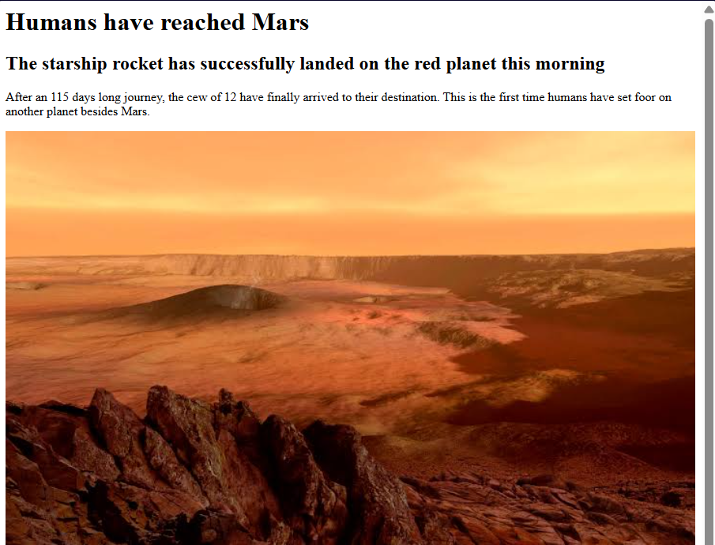

# HTML Fundamentals
Hypertext Markup Language (HTML) is the standard markup language for creating web pages. It describes the structure of a web page semantically and originally included cues for the appearance of the document. 

- [HTML Fundamentals](#html-fundamentals)
  - [Concepts Covered](#concepts-covered)
  - [Basic HTML Structure](#basic-html-structure)
  - [HTML Elements](#html-elements)
    - [HTML Nesting](#html-nesting)
    - [HTML Document Structure](#html-document-structure)

## Concepts Covered
```yaml
01_html_basics/   
├── 01_news_article/  #  HTML Nesting (<div>), <h1>, <h2>, <p>, 
│   ├── 01_news_article.html   
│   └── mars.jpg
├── 02_signup_page/    # <button>, <input>, linebreaks (<br>),
│   ├── 02_signup_page.html    
│   └── build_google.html
│   └── build_google_structured.html   # HTML document structure
├── 03_portfolio_page/    # Anchor tags (<a>)
│   ├── header.html 
│   └── experience.html     
├── image.png
├── index.html            
└── README.md
```

## Basic HTML Structure
Below is the basic structure of an HTML document shown via a simple news article example.

```html
<div>
    <!-- Header 1 -->
    <h1> Humans have reached Mars </h1>

    <!-- Header 2 -->
    <h2> The starship rocket has successfully landed on the red planet this morning </h2>

    <!-- Paragraph -->
    <p> After an 115 days long journey, the cew of 12 have finally arrived to their destination. This is the first time humans have set foor on another planet besides Mars. </p>

    <!-- Image  -->
    

</div>
```

The above code renders the following output:


## HTML Elements
### HTML Nesting
HTML nesting is the practice of placing one HTML element inside another element. The element on the inside is called a child, while the element on the outside is called its parent.

In the above code snippet, `<div>` is the parent element, while `<h1>`, `<h2>`, `<p>`, and `` are its child elements. The nested child elements are siblings of each other as they share the same parent element. 

Nesting allows for a more organized and structured HTML document. It also allows for better styling and manipulation of elements using CSS and JavaScript.

### HTML Document Structure
Every HTML page follows the same skeleton, shown below using the Google homepage clone (`build_google_structured.html`).

```html
<!doctype html>
<html>
    <head>
        <link rel="stylesheet" href="styles.css">
        <title>Google.com</title>
    </head>
    <body>
        <div style="text-align: center">
            <!-- visible content -->
        </div>
    </body>
</html>
```

- **`<!doctype html>`**: tells the browser to render the page as modern HTML. It's a declaration that comes first.
- **`<html>`**: the root element that informs the browser the elements to be rendered in HTML. Everything else on the page is nested inside it.
- **`<head>`**: holds information/metadata about the page that visitors don't see directly in the page content.
  - `<title>` is the text shown in the browser tab/address bar.
  - `<link>` pulls in external resources. With `rel="stylesheet"` it loads a CSS file for styling, but depending on `rel` it can also be used for things like website icons.
- **`<body>`**: holds everything visitors actually see, such as the logo (``), search bar (`<input>`), buttons (`<button>`), and the privacy text with its link (`<p>`, `<a>`).
- **`<div>`**: a generic container inside the body used to group elements, either to style them together or just to organise the page.

In short: `<html>` wraps the page, `<head>` describes it, and `<body>` displays it.

